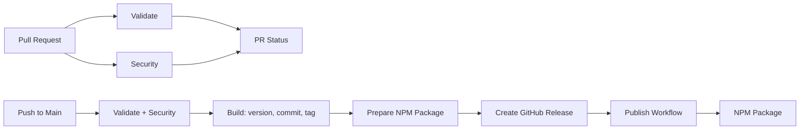

# GitHub Actions Workflows Documentation

This document describes the GitHub Actions workflows used in this repository.

## Workflow Overview

CodeQL (`codeql.yml`) runs independently on pull requests, pushes to `main`
and a daily schedule.

## Important Setup Requirements

### Personal Access Token for Release Workflow

The Main workflow creates GitHub releases that trigger the Publish workflow.
Due to GitHub's security features, workflows triggered by the default
`GITHUB_TOKEN` cannot trigger other workflows (this prevents infinite loops).

**The Main workflow has no fallback to `GITHUB_TOKEN`.** The `RELEASE_TOKEN`
secret is required: the `build` job checks out `main` with it so the version
commit and tag can be pushed, and the `create-release` job creates the release
with it so the Publish workflow fires.

**To configure it:**

1. Create a fine-grained Personal Access Token (PAT) with the following
   permissions:
   - `contents:write` - To push the version commit and tag and create releases
   - `actions:read` - To trigger workflows

2. Add the PAT as a repository secret named `RELEASE_TOKEN`:
   - Go to Settings → Secrets and variables → Actions
   - Click "New repository secret"
   - Name: `RELEASE_TOKEN`
   - Value: Your PAT

## Workflows

### 1. Pull Request Workflow (`pr.yml`)

**Purpose**: Validates and tests all pull requests.

**Triggers**: Pull requests to `main` branch, manual workflow dispatch

**Jobs**:

- **validate** (`reusable-validate.yml`, with `validate-changesets: true`):
  - `test`: Runs the test suite with coverage and uploads the coverage report
    as a workflow artifact
  - `lint`: Type checking, ESLint, Prettier, markdownlint, yamllint, depcheck,
    actionlint, then `pnpm changeset:status` to require a changeset on the
    branch
- **security** (`reusable-security.yml`, with `run-osv-scan: false`):
  - `audit`: `pnpm audit --audit-level high`
  - `osv-scan`: skipped on pull requests
- **pr-status**: Aggregates the results of `validate` and `security` into a
  single check for branch protection

Together, `validate` and `security` run the same checks as `pnpm verify`.
Keep them in sync when editing the `verify` script.

### 2. Main Workflow (`main.yml`)

**Purpose**: Handles versioning and release creation when changes are merged
to main.

**Triggers**: Push to `main` branch

**Jobs**:

- **validate** and **security**: Same reusable workflows as the PR workflow,
  with the OSV scan enabled and changeset validation disabled
- **build** (needs `validate` and `security`):
  - Builds the project so the custom changelog generator is available
  - Checks for changesets (fails if releasable commits lack changesets)
  - Versions packages using changesets, commits the result with
    `[skip actions]` and pushes the `vX.Y.Z` tag
  - Rebuilds with the bumped version and uploads `dist/` as a workflow
    artifact
- **npm** (`Prepare NPM Package`, runs when `ENABLE_NPM_RELEASE=true` and a
  version was produced):
  - Strips `private` and `scripts.prepare` from `package.json`
  - Packs the npm tarball, uploads it as a workflow artifact and generates a
    build provenance attestation for it
- **create-release** (`Create GitHub Release`):
  - Checks out the new tag, generates a CycloneDX SBOM and `dist` archives
  - Generates build provenance attestations for the `dist` files, SBOM and
    archives
  - Creates the GitHub release with release notes extracted from
    `CHANGELOG.md`, using `RELEASE_TOKEN` so the Publish workflow is triggered

**Important**: Requires the `RELEASE_TOKEN` secret.

### 3. Publish Workflow (`publish.yml`)

**Purpose**: Publishes the package to npm after a release.

**Triggers**:

- Release published event
- Manual workflow dispatch (with a `tag` input, e.g. `v1.2.3`)

**Jobs** (both require the `ENABLE_NPM_RELEASE` variable):

- **fetch-npm-package**: Waits for the Main run that built the release to
  finish, downloads the tarball it built and attested, and verifies the packed
  version matches the release tag
- **npm**: Publishes that tarball to npm as-is with `--provenance`,
  authenticating via GitHub OIDC trusted publishing

### 4. CodeQL Workflow (`codeql.yml`)

**Purpose**: Static security analysis of the JavaScript/TypeScript sources.

**Triggers**: Push to `main`, pull requests to `main`, daily at 00:00 UTC

**Jobs**:

- **analyze**: Runs the CodeQL `javascript-typescript` analysis from source and
  uploads findings to the Security tab. It does not install dependencies.

## Configuration

### Required Secrets

| Secret          | Purpose                                                   | Required For  |
| --------------- | --------------------------------------------------------- | ------------- |
| `RELEASE_TOKEN` | PAT used to push version commits/tags and create releases | Main workflow |

No `NPM_TOKEN` is needed: npm publishing uses OIDC trusted publishing.

### Repository Variables

| Variable             | Purpose               | Default |
| -------------------- | --------------------- | ------- |
| `ENABLE_NPM_RELEASE` | Enable NPM publishing | `false` |

## Setup Instructions

### 1. Create a Personal Access Token for Releases

Create a fine-grained PAT with:

- **Repository access**: Your repository
- **Permissions**: Contents (Write), Actions (Read)

Add as `RELEASE_TOKEN` secret.

### 2. Enable NPM Publishing

Set the `ENABLE_NPM_RELEASE=true` repository variable and configure the
package for trusted publishing from this repository on npmjs.com. Publishing
authenticates with GitHub OIDC, so no `NPM_TOKEN` secret is needed.

## How It Works

1. **Developer creates PR** with changes and changeset
2. **CI validates** the PR (tests pass, lint clean, changeset present, audit
   clean)
3. **PR is merged** to main branch
4. **Main workflow runs**:
   - Re-runs validation and security scans
   - Checks for changesets and versions packages
   - Commits the version bump and pushes the tag
   - Packs and attests the npm tarball
   - Generates the SBOM and creates the GitHub release
5. **Publish workflow triggers** (requires `RELEASE_TOKEN`):
   - Publishes the attested tarball to NPM

## Troubleshooting

### Publish Workflow Not Triggering

- Verify `RELEASE_TOKEN` secret is configured
- Ensure the PAT has `contents:write` and `actions:read` permissions
- Check that the release was created (not draft)

### NPM Publish Failing

- Check `ENABLE_NPM_RELEASE` variable is set to `true`
- Ensure the package is configured for trusted publishing from this repository
- Ensure package.json version doesn't already exist

### Missing Changesets

- Main workflow will fail if releasable commits lack changesets
- Add changesets with `pnpm changeset`

## Best Practices

1. **Always include changesets** in PRs with changes
2. **Configure `RELEASE_TOKEN`** for automatic publishing
3. **Keep secrets secure** and rotate regularly
4. **Monitor workflow runs** for failures
5. **Use `pnpm verify`** before pushing code
